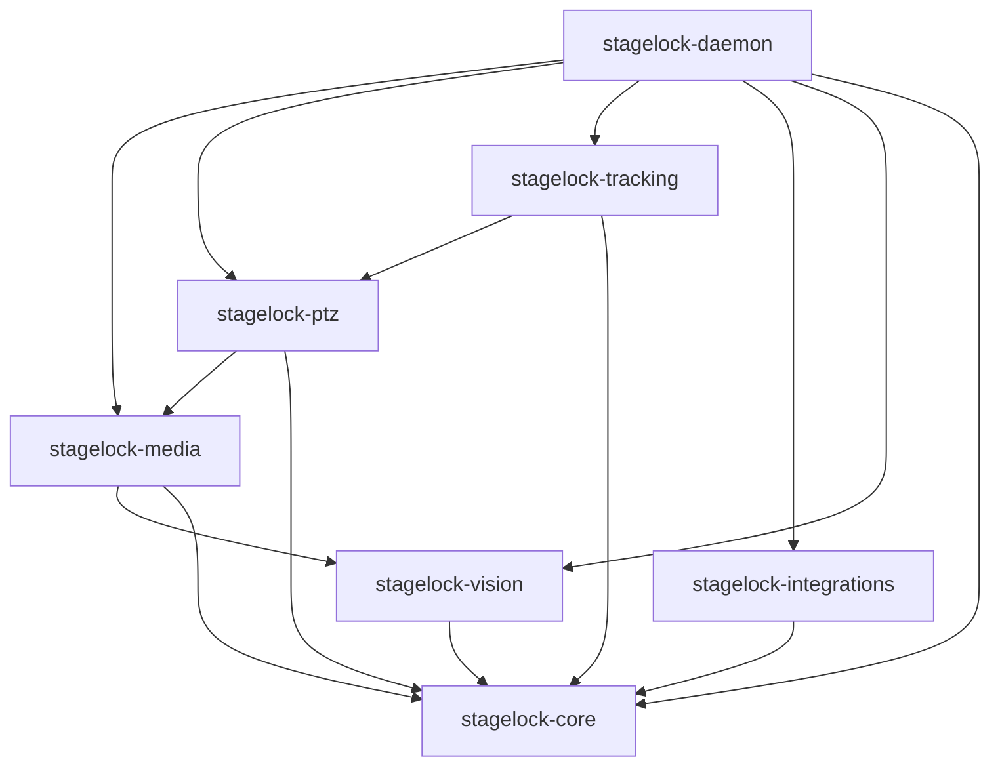

# Rust Workspace (`crates/`)

Core headless media, AI computer vision, closed-loop PTZ tracking, hardware camera control, broadcast integrations, and control server crates powering **StageLock**.

## Crate Map

| Crate | Purpose |
| :--- | :--- |
| [`stagelock-core`](./stagelock-core/README.md) | Shared domain types, telemetry schemas, camera calibration models, and embedded SQLite (`stagelock.db`) persistence store |
| [`stagelock-media`](./stagelock-media/README.md) | Multi-GPU capability probe, GStreamer live ingest (`gst-native` or CLI bridge), dynamic NDI® 6 loader/sender, BGRA color grading & Unsharp Mask |
| [`stagelock-vision`](./stagelock-vision/README.md) | ONNX Runtime (`ort`) person/pose/Re-ID inference (`RTMDet`, `RTMPose`, `OSNet`), spatial HSV fallback, Camera Motion Compensation, BoT-SORT tracker, Face-ROI sharpness |
| [`stagelock-tracking`](./stagelock-tracking/README.md) | One-Euro filter, anatomical Rule-of-Thirds framing solver, 5-stage smooth PTZ motion controller, 2-tier motion-gated auto-focus |
| [`stagelock-ptz`](./stagelock-ptz/README.md) | Unified `PtzDriver` + Layer-1 hardware imaging across VISCA-over-IP, ONVIF Profile S/T, NDI PTZ, Canon XC, Panasonic AW, and Mock PTZ |
| [`stagelock-integrations`](./stagelock-integrations/README.md) | vMix TCP Tally (`:8099`) & HTTP XML switching (`:8088`), Bitfocus Buttons Control API client, Stream Deck key/dial router |
| [`stagelock-daemon`](./stagelock-daemon/README.md) | Axum REST/WebSocket/MJPEG server, LAN PWA static host, OSC UDP `:9000` listener, and per-camera 30 Hz tracking supervisor |

## Dependency Architecture



## Workspace Commands

```pwsh
# Run all unit & HTTP API integration tests (happy paths + failure paths)
cargo test --all-targets

# Build optimized release daemon binary
cargo build --release -p stagelock-daemon

# Optional native GStreamer (requires GStreamer MSVC/dev headers installed)
cargo check -p stagelock-media --features gst-native

# Optional ONNX Runtime execution providers (stagelock-vision)
cargo check -p stagelock-vision --features onnx            # CPU / default
cargo check -p stagelock-vision --features onnx-cuda       # NVIDIA CUDA
cargo check -p stagelock-vision --features onnx-directml   # Windows DirectML (AMD/Intel/NVIDIA)
cargo check -p stagelock-vision --features onnx-coreml     # Apple CoreML
```
